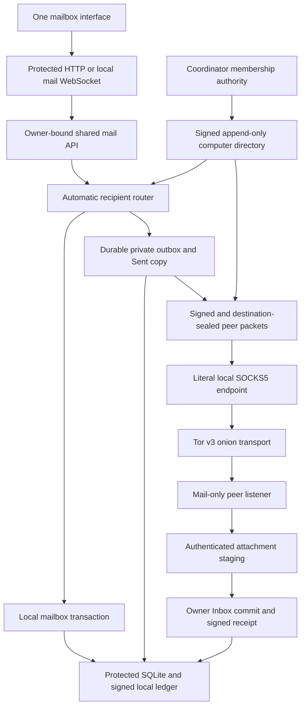

# Blockchain Mail

**A Windows reference implementation of private mail over Tor, with authority-signed local ledgers, account-owned mailbox views, and encrypted attachment streaming.**

Copyright (C) 2026 RUSSELL PHILIP SMITHSON

Project-authored source is distributed under GNU GPL version 3, subject to the scope and exceptions recorded in [LICENSE](LICENSE), [NOTICE](NOTICE), [COPYRIGHT](COPYRIGHT), and [THIRD_PARTY_NOTICES.md](THIRD_PARTY_NOTICES.md). Third-party software retains its original notices, licenses, and attribution. This README describes the implementation and its measured evidence; it does not certify institutional compliance, independently reviewed cryptographic security, or fitness for a regulated deployment.

The application retains the internal name **Workspace391** and version **3.9.1-local.1** in its launchers, protocol identifiers, source inventories, and compatibility records. Those identifiers are part of the existing implementation. The public project name is **Blockchain Mail**.

## 1. Scope, result, and interpretation

Blockchain Mail provides one compose workflow for mail delivered on the current computer and mail addressed to another admitted computer in a private Torus group. An account opens its mailbox, receives an assigned `mail@127…` identity, chooses **New message**, enters the recipient's complete assigned address, optionally attaches files, and presses **Send**. The application derives the destination from a signed directory. Users do not select a local, Tor, or Internet transport to send private group mail.[^routing]

Each computer owns its protected vault, local signing authority, account credentials, Tor onion identity, and stored message history. A coordinator admits computers into a group through single-use connection codes. The receiving computer commits a message into the appropriate account's mailbox and returns an authority-signed durable receipt. The sender retains its own Sent copy and a separate delivery-attempt record. Attachment contents move in bounded encrypted chunks rather than becoming one large JSON mail object.[^torus]

“Blockchain” in this project refers to an append-only sequence of locally authority-signed state-transition records. Each block commits a previous-block hash, an event Merkle root, an event-list digest, and the resulting state hash. There is one local writer and signing authority per vault. The computers do not execute a replicated consensus algorithm, elect validators, mine blocks, settle a public cryptocurrency, or synchronize every account's ledger into one global chain. The group directory is coordinator-signed membership data, not a distributed consensus ledger.[^store]

The current verification snapshot records **436 passing regression tests, one skipped test, zero failures, and 47 passing native source compilation/policy checks**. Windows' ZIP viewer and extractor accepted the portable package; application preparation verified long paths and preserved an existing private-state marker on repeated opening. Two isolated real Tor onion services, running on **one physical computer**, exchanged private messages in both directions through the shared protected mail API. Each account had its own Inbox and Sent copy; other tested accounts had none. A streamed **8,388,625-byte attachment**, or 8 MiB plus 17 bytes, arrived with the same source and destination SHA-256 digest.[^release]

The interactive desktop test was stopped by the user. Its recorded status is `GUI_NOT_COMPLETED_USER_STOPPED`. The snapshot therefore does **not** claim completed human recovery-dialog interaction, visually observed GUI sending and receiving, or a successful connection between two physical computers. Source tests, native policy checks, archive acceptance, and actual protected-API Tor delivery are separate evidence categories. They should remain separate in research reports and procurement assessments.

## 2. What the system implements

| Concern | Implemented behavior | Boundary |
|---|---|---|
| Mail composition | One form routes local and admitted private Torus recipients automatically | Private group addressing; no assertion of general public Internet deliverability |
| Account identity | First login reserves an available logical address in a signed register | Account identity and authentication token remain distinct from the assigned alias |
| Mailbox access | Inbox, Sent, message content, attachments, and delivery attempts are filtered by authenticated owner | A vault recovery-key holder controls the entire operator vault |
| Computer membership | One connection code causes automatic invitation, card admission, and directory import | The coordinator is a trusted membership authority |
| Transport | Onion-only peer requests through a literal local SOCKS5 endpoint | Tor availability and endpoint operation remain external conditions |
| Delivery result | Destination-signed receipt after committed mailbox storage | A receipt proves application acceptance, not that a human read the mail |
| Storage | Encrypted SQLite values, encrypted authority/credential files, and encrypted attachment chunks | Running memory and clear structural metadata are outside the at-rest claim |
| Ordinary admission | Local and private Torus mailbox sends use zero-cost admission | Historical credit/puzzle records remain for compatibility |
| Mailbox capacity | No fixed mailbox byte-storage quota | Record counts, individual metadata bounds, filesystem precision, and disk space still apply |
| Enrollment waiting | No fixed overall enrollment or directory-handshake deadline | Close cancels waiting; authorization refusals are not converted into success |
| Attachment recovery | Up to three attempts for the same recoverable chunk exchange | The final mail submission is not automatically repeated |

The executable implementation lives primarily in `app/src/*.mjs` and `app/web/*`. Additional TypeScript, compiled application assets, native-console code, legacy puzzle workflows, and supplied research/provenance materials remain in the repository. Their presence does not mean every historical prototype or theoretical model runs in the private-mail path.

## 3. Installation and normal operation

### 3.1 Verified portable distribution

The GitHub repository provides the full checkout described in Section 3.2. A separately supplied `W391.zip` portable distribution uses the workflow below; its verified artifact identity and acceptance evidence are recorded in Section 16. The [packaging tools](build-tools/README.md) provide the source for building the short-path portable wrapper.

1. Extract `W391.zip` into a new directory, preferably under a short Windows working root such as `D:\Codex`.
2. Open the extracted `W391` folder and double-click **Open Workspace.vbs**.
3. Allow the bundle to prepare its complete application on first opening.
4. Create a protected workspace or unlock an existing protected workspace with its original four recovery words.
5. Save newly generated recovery words separately and privately.
6. Open the mailbox. Tor and a new standalone private group start automatically when the protected launcher supplies the Tor configuration.
7. Copy the account's displayed assigned address when sharing it with another group member.

The short outer bundle addresses Windows Explorer's ZIP/path limitations without discarding the full application. It contains a preparation wrapper and an embedded payload. The preparation code validates archive paths, file identities, and content hashes before publishing the application directory. Repeated preparation recognizes an existing prepared application and preserves its private state. The current evidence records 30 passing extractor checks, including rejection of path traversal, alternate streams, collisions, private-state injection, incorrect hashes, and pre-existing destinations.[^release]

The desktop launcher requires Windows x64, Windows PowerShell 5.x, and an installed Microsoft Edge WebView2 runtime. The complete portable payload supplies its pinned Node runtime, console SDK assets, and Tor runtime. Normal opening does not require a separate Tor installation or a manually chosen mail-transport port. An occupied local application port is reported; the launcher does not solve a collision by terminating an unrelated process.

### 3.2 Source checkout

This repository includes the pinned runtime and SDK assets needed by the workspace launcher, together with their component notices. On Windows, clone with long-path support and without newline conversion so the sealed files retain their exact bytes:

```powershell
git clone --config core.longpaths=true --config core.autocrlf=false https://github.com/LKVexa/Blockchain-Mail.git D:\Codex\Blockchain-Mail
Set-Location D:\Codex\Blockchain-Mail
& .\runtime\node.exe .\app\tools\check-package.mjs
.\Start-Workspace.cmd
```

Use a fresh destination. For Windows Explorer downloads, prefer the short-path portable release bundle rather than attempting to extract the entire source-tree ZIP through Explorer. The [packaging tools](build-tools/README.md) provide editable extractor and launcher sources. The repository preserves the optional recovered native utility's [known source-availability limitation](native/NATIVE-INTEGRATION.md); this is separate from ordinary private mail.

The full workspace entry points are [Start-Workspace.cmd](Start-Workspace.cmd) and [Start-Workspace.vbs](Start-Workspace.vbs), backed by [Start-Workspace.ps1](Start-Workspace.ps1). Opening them requires the matching sealed runtime and native assets listed in [INTEGRATED_BUILD.json](INTEGRATED_BUILD.json). A source checkout is not assumed to be launchable merely because its JavaScript files are present. Check that the required assets and licenses are included, verify the inventory, and use the documented launcher rather than bypassing its gate.

The application package declares Node **24.19.0 or later**, uses the built-in SQLite and cryptographic APIs, and declares no npm package dependencies for its standalone server/test path. Its `npm` scripts are convenience aliases; installing a new dependency tree is not a substitute for the supplied runtime or integrity manifests. Historical framework source and vendored compiled browser assets are preserved, but the supported standalone mail path is the checked-in JavaScript implementation.[^runtime]

For a checkout with the matching supplied runtime, a regression run from the `app` directory is:

```powershell
Set-Location .\app
& '..\runtime\node.exe' tools/run-tests.mjs
```

For a researcher using a separately managed compatible Node runtime, the equivalent command is `node tools/run-tests.mjs` from `app`. Record the actual Node version, platform, architecture, and dependency/runtime hashes. A result under another environment is a new observation, not an automatic extension of the published Windows result.

The package inventory can be checked through `app/tools/check-package.mjs`; inspect its invocation help/source and run it against the intended application root. Tests create disposable working state and write evidence under `app/evidence/runs`. Production service startup is different: recovery material is provided through the protected launcher's process-owned input channel, not as a normal command-line argument. The expert CLI in `app/src/main.mjs` supports protected initialization, serving, verification, checkpoints, restore, status, and stop. Read that interface before automating it, and keep recovery words out of shell history and shared logs.

### 3.3 Connecting another computer

On the first computer, open **Settings → Connected computers → Connect another computer**, then copy its connection code. Open the same application on the second computer with its own vault and recovery words. In **Settings → Connected computers**, paste the code and select **Connect this computer**. Registration records and the signed directory are exchanged automatically; users do not pass invitation, computer-card, and directory files back and forth.

The code identifies which private group the second computer should join. It is a scoped authorization capability, not the first computer's vault key, mailbox token, or Tor secret key. Share it only with the intended computer. The application retains one stable child card across an interrupted enrollment so an acknowledged or unacknowledged registration can be recovered without inventing a second identity.

Keep the first computer running while admitting members and fetching new registrations. It also forwards expanded routes that do not have a direct admitted neighboring link. Sending between already registered direct neighbors can operate without that relay when both endpoints are running and have the required signed directory. An offline application cannot receive mail; this release is not installed as an always-running operating-system mail service.

## 4. Component and trust architecture



There are three distinct authority relationships. First, the Windows launcher owns the processes and verifies the packaged executable inventory. Second, each vault authority signs local state transitions and mailbox delivery records. Third, the group coordinator signs the mapping from admitted virtual computer namespaces to public signing/encryption keys and onion endpoints. Combining these roles conceptually would obscure which key can authorize which operation.

The browser does not send plaintext mailbox API requests directly to the peer onion service. It calls the local protected interface. The peer listener exposes only enrollment, directory, delivery, receipt, and attachment operations; it does not expose the desktop, terminal, vault bootstrap, generic administration, or the account-credential API. Forwarding computers participate in the authenticated route but receive a destination-sealed payload, not permission to open another computer's vault.[^peer]

The local runtime guard restricts ordinary Node socket operations to the literal `127.0.0.1`, rejects ambiguous listeners, blocks ordinary DNS resolver paths, UDP operations, and child-process execution from the server. Tor itself is supervised outside that JavaScript guard. This is application-level defense in depth. It is not a Windows firewall policy, process-isolation proof, or hostile-code sandbox: a compromised host or intentionally privileged native component is outside that claim.[^guard]

## 5. Logical address model

New private addresses have the form:

```text
mail@127.a.b.c:identifier
```

Each of `a`, `b`, and `c` is a canonical decimal octet in `0..255`. `identifier` is a canonical positive decimal string of one through 32 digits, with no leading zero. New automatic assignments start in a 20-digit sequence, such as:

```text
mail@127.0.0.1:10000000000000000001
mail@127.0.0.2:10000000000000000002
```

The identifier is **not a TCP port**. It is not parsed into a JavaScript floating-point number, passed to a socket constructor, looked up as public DNS, or interpreted as a Windows listener. The application retains it as an exact string. Generated sequence values use `BigInt` before conversion to canonical decimal strings. This keeps identities above `2^53` exact.[^addresses]

The physical `127.0.0.1` service endpoint and a logical mailbox beginning with `127.0.0.1:` are different objects. Actual IP loopback behavior is defined by Internet host requirements; this application's address overlay deliberately uses that familiar notation as a private logical namespace. It does not alter routing tables or make another machine's loopback interface remotely reachable.[^loopback]

The address namespace admits `2^24` host combinations and `10^32 - 1` positive identifier values per host. Its syntactic cardinality is therefore:

```text
N_namespace = 16,777,216 × (10^32 − 1)
```

That expression describes representable names. It is not a claim that this process can simultaneously operate that many accounts, store that many registrations, or enumerate the complete namespace. The present application supports **256 computers per private group** and **64 accounts per computer**. The signed local address register separately has a **65,535-claim** capacity. These are operational bounds, distinct from the address grammar.

For a host `127.a.b.c`, the expanded computer index is `h = 65536a + 256b + c`. Expanded peers use an identifier `v` followed by six lowercase hexadecimal digits representing `h`. Host index 1 is reserved for the coordinator, whose stable computer ID remains `n00` and whose new prefix is `127.0.0.1:`. Other expanded coordinates are derived from `x = floor(h / 4096)` and `y = h mod 4096`.

The first login checks availability and commits the reservation and exclusive alias ownership together under the Store transaction. A request cannot silently take an already reserved complete domain. The account's original login identity and token remain its authentication identity; the displayed mail address is an assigned alias. Historical `rmail@` aliases and prior portless assignments remain valid. They are not rewritten or renumbered solely because the default spelling is now `mail@`.

Uniqueness has a scope. Local claims are unique within a signed vault history; admitted expanded hosts are unique within the coordinator's group directory. Independent groups can use the same textual mailbox name because envelopes also bind a network ID. Copying a live vault to another machine does not create an independent new computer: it copies authority and history and can create divergent local continuations. Fresh computers should receive fresh vault and onion identities.

## 6. Directory, membership, and enrollment protocol

A network ID is a 128-bit random identifier represented as 32 lowercase hexadecimal characters. A signed invitation binds that network ID, the root public signing key, the root onion endpoint and virtual service port, the invitation ID, and the assigned computer slot. A child card adds its own signing key, X25519 encryption key, onion endpoint, and the complete signed invitation. The child signs its card. The root directory signs a canonically ordered set of admitted cards and an increasing revision.[^membership]

The validators require exact record fields and supported versions rather than accepting arbitrary extension fields. Canonical public/private key encodings and algorithm types are checked. A directory rejects duplicate node IDs, signing keys, encryption keys, onion endpoints, and reused grants. Invitations in the directory must agree with the root card's endpoint. Imports pin the network and root authority, require the exact local card, reject older revisions, reject changed contents at the same revision, and reject silent replacement or removal of previously admitted cards.

Connection codes use the `w391:` prefix followed by canonical base64url-encoded enrollment data. The data contains the signed invitation and a random 256-bit capability. The root vault retains a domain-separated hash of the capability/invitation combination, not an unprotected code in the directory. A code normally expires after seven days and admits one computer. Once consumed, an exact replay of the same admitted card can recover its directory even after that authorization window; a different card cannot reuse it.

Enrollment is atomic at the authority boundary. Root processing verifies the capability, leased invitation, child card signature, group binding, and card identity before advancing the directory and recording the consumed card hash. An interruption after admission but before the child receives its reply therefore has a recoverable state: the same persisted card can fetch the already signed directory. It must not generate a new key pair and pretend that a second enrollment was the original transaction.

Enrollment and directory requests have no fixed overall client-side handshake deadline. A waiting SOCKS CONNECT can remain pending while the workspace is open. Recoverable unpublished/unreachable onion conditions are retried with backoff beginning at 250 ms and capped at five seconds. Permanent authorization refusals and malformed records remain failures. This behavior does not remove authentication validity windows, bounded request/reply sizes, or the server's resource controls.

Directory refresh signs a fresh query after a delayed CONNECT succeeds, avoiding reuse of a stale signed timestamp merely because Tor reachability took a long time. Queries bind network, node, random nonce, and time. The root checks the admitted signing key and the query's validity window. Ordinary refresh is scheduled approximately once per minute, and a private recipient not found in a child's current directory can trigger a verified refresh before routing.

Closing the workspace aborts outbound sockets and retry waits. Shutdown waits for already authorized mutation work to finish rather than destroying Store underneath a commit. This distinction matters: canceling a transport wait is not proof that an admission already accepted by the root was rolled back. The persisted child card and root directory remain the basis for recovery on the next opening.

## 7. Torus topology and forwarding

The supplied TORUS RAMWS reference contains a three-by-three torus with nine nodes and 36 directed links. Its exact authored inputs and standalone reader files are retained and hash-checked in `app/provenance/torus-ramws`. The original program is a local emulated-CPU demonstration. Its authored messages and assertions are not represented as real network execution, and a general JA compiler is not claimed to run in the mail path.[^topology]

The mail adapter preserves the original `n00..n22` edges for legacy members. Expanded peers occupy a deterministic 4096-by-4096 wrap grid. A pair of expanded peer vertices is adjacent when one coordinate is equal and the other differs by one modulo 4096. The coordinator has additional authenticated backbone links to expanded peers. Sparse registrations therefore do not require every intermediate coordinate in a 16-million-slot grid to be online or registered before useful routing is possible.

For a signed directory `D`, routing constructs the admitted graph `G(D)` and performs breadth-first search from the source computer to the destination. The result is a simple path: no repeated vertices, admitted endpoints, and a permitted edge at every step. Validators on the mail service and peer transport use the same directory-aware neighbor function. Route length is bounded by the number of admitted directory entries, rather than the former hard nine-hop ceiling.

Membership additions do not withdraw existing legacy, grid, or coordinator links. This preserves the validity of previously signed outbox routes when the directory grows. A dynamically reindexed ring would remove old adjacency relations on insertion; this implementation avoids that mutation. The coordinator exception is explicit, so its legacy ID is never confused with an expanded host-index encoding.

The graph is an admission graph, not a live reachability monitor. An admitted computer can be offline while its card remains in the directory. Breadth-first search does not probe each route, dynamically remove offline nodes, or automatically resubmit final mail over another route. Keep the selected forwarding computers running. A direct admitted neighbor link is preferable when available; other expanded routes commonly use the coordinator backbone. Operational studies should report the actual chosen path and the availability assumptions.

At each hop, the current forwarding computer signs a wrapper binding the previous and next node, hop index, payload, timestamp, and fresh nonce. The next computer validates both the immediate predecessor and the full source-to-destination route. Intermediate computers can inspect routing metadata and the destination-sealed packet, but do not obtain the destination vault key or X25519 private key. This is authenticated forwarding over Tor; it is not a decentralized mail-consensus protocol.

## 8. Cryptographic layers and serialization

The project uses several cryptographic layers for different purposes. They should not be collapsed into one statement such as “everything is end-to-end encrypted.”

### 8.1 Canonical records, identifiers, and signatures

`crypto.mjs` implements a restricted canonical serializer for null, booleans, strings, safe integers, arrays, and plain objects with sorted keys. Unsupported values are rejected. Signature inputs have the form `domain + "\n" + canonical(record)`. Signature domains distinguish invitations, cards, directories, envelopes, packets, receipts, queries, hops, stamps, and ledger records. The version remains inside the signed record even when compatible versions share a signature domain.

SHA-256 supplies record digests, content identifiers, blob identifiers, state roots, and Merkle nodes. Random mail/network/storage IDs use 16 random bytes; bearer tokens use 32 random bytes. Ed25519 signs authority records and peer protocol records through Node's cryptographic library. RFC 8032 specifies the underlying EdDSA construction; selecting the primitive does not independently validate this application's protocol composition.[^ed25519]

The inner stored-message codec retains a versioned `VEM-OBJECT/2` frame. It explicitly counts UTF-8 payload bytes and verifies canonical reconstruction. Message contents, attachment references or compatible inline data, and raw-mail data are sealed with ChaCha20-Poly1305 under the vault's inner message-sealing key, with the chain ID and message ID bound as associated context. The encrypted object's hash becomes its blob identifier.[^inner]

### 8.2 Outer vault protection

The protected vault wraps state, block and object values, authority files, credential files, and backup metadata in AES-256-GCM. HKDF-SHA-256 derives distinct use keys from the external master key and random vault metadata. Associated data binds the vault metadata, usage domain, and row or file identifier. A stored value cannot be moved to a different table or row and still authenticate under the same context.[^vault]

The outer envelope format is `VEXA127-VAULT/1`, with a random 12-byte nonce and a 16-byte authentication tag. The implementation tracks newly generated nonces in memory and rejects repetitions in the relevant use domain. AES-GCM's nonce requirements and AEAD security model are defined in NIST SP 800-38D. This use of a standardized mode is not a claim of FIPS validation or a validated cryptographic module.[^gcm]

Four generated recovery words encode 16 random bytes using the supplied word representation. Their ordered normalized representation is mapped through SHA-256 to a 32-byte master key. The random generator therefore contributes 128 bits of input entropy; the 256-bit AES key representation does not turn low-entropy human-chosen words into a strong password. The word mapping is not a memory-hard password KDF. New workspaces should use generated words and preserve their order.[^vault]

### 8.3 Local protected API

The browser and server derive separate request and response AES-GCM keys using HKDF-SHA-256, the current random run ID, and direction-specific context strings. A frame binds protocol version, run ID, request ID, issued timestamp, nonce, and ciphertext. Response decoding additionally binds the response to the original request ID and timestamp.[^wire]

The server rejects requests outside a two-minute timestamp window and records both frame IDs and nonces in a five-minute replay journal. The journal is bounded; capacity refusal returns an explicit busy response rather than silently evicting live replay protection. Inner requests still carry the account bearer token, so passing the outer vault channel is not itself authorization to read every mailbox through the public mail API.

The same protected codec is used over HTTP and the local mailbox WebSocket. That avoids creating an unrelated weak protocol merely because the UI uses a persistent connection. The master vault key is not transmitted in an HTTP frame. It remains present in the authorized browser/server processes during use, which is an intentional part of the endpoint trust model.

### 8.4 Destination-sealed peer transport

For each mail or attachment packet, the sender generates an ephemeral X25519 key pair and derives a shared secret with the destination card's stable public encryption key. HKDF-SHA-256 derives a 32-byte AES-GCM key using a salt derived from the network ID and context containing the authenticated packet header. The header binds IDs, digest, source, recipient, route, creation and expiry times, ephemeral public key, nonce, and attachment-specific fields when applicable.[^peercrypto]

The sender signs the sealed packet with its admitted Ed25519 authority. The destination validates the directory, route, packet signature, timing, and endpoint key binding before opening the payload. The opened envelope must agree with the outer identity and route fields, and its own signed content digest is checked again. This provides explicit cross-layer binding instead of trusting a successful decryption as authorization by itself.

X25519 and HKDF are standardized in RFC 7748 and RFC 5869. The destination key is stable and can decrypt recorded packets if an attacker later obtains it and the packet's public ephemeral key. This release does not claim forward secrecy against later destination-key compromise, per-recipient key ownership, group MLS, or post-quantum confidentiality. Tor's transport protections are an additional layer, with their own endpoint and traffic-analysis assumptions.[^x25519][^hkdf]

## 9. Local WebSocket and onion transport surfaces

The local mail WebSocket lives at `/api/mail/socket` with subprotocol `workspace.mail.v1`. Its framing implementation is derived from the supplied HERMIT RFC 6455 source, with provenance retained. Upgrade admission pins the configured literal loopback origin, host, path, and protocol. Tickets are one-use, owner-bound, run-bound, purpose-bound records; a bearer credential is not placed in a query string.[^socket]

After the ticket's first frame is consumed, protected requests are decrypted and dispatched only through the narrow shared mailbox API. The connection rechecks the authenticated owner and rejects attempts to use another account on the same socket. Arbitrary terminal operations, generic vault bootstrap, and unapproved administrative routes are not added by exposing a WebSocket.

The native console independently constrains allowed resource and navigation origins. Its file-picker permission is granted only for explicit user-initiated access from the allowed console HTTP origin. Browser save flows therefore have a scoped user-action boundary; automatic remote peer activity is not permission to read arbitrary local files. Native resource and file-permission policy checks are part of the 47-check source suite.[^native]

Peer traffic uses SOCKS5 domain-name requests to the local Tor SOCKS listener. The client sends a validated v3 onion name directly to Tor and does not resolve it through a local DNS lookup or fall back to a public IP. The implementation checks the 56-character base32 onion address, decoded version byte, and checksum before opening that route. SOCKS5 domain addressing and Tor's onion-specific behavior are documented by their primary specifications.[^socks][^onion]

The onion service exposes virtual port 80, mapped to a loopback peer listener, normally at port 8788. The UI normally uses local port 8787; the supervised Tor SOCKS and control defaults are 19150 and 19151. These are implementation defaults, separate from mailbox identifiers. The protected launcher chooses the necessary process configuration; normal mail composition does not ask the user to select these ports.

Tor supervision verifies the supplied runtime inventory, creates per-computer state and onion identity directories, records ownership, and drains bounded diagnostic output. Shutdown uses authenticated SAFECOOKIE control processing and controlled shutdown for owned processes. The verified release evidence records two graceful stops with no forced termination. Tor control protocol authentication and shutdown semantics are defined in the Tor specifications.[^control]

## 10. Ledger, atomic storage, and rollback boundaries

`Store.mutate` starts an SQLite `BEGIN IMMEDIATE` transaction, authenticates the actor, validates the current signed state head, applies the operation, checks invariants, and commits the new encrypted state and signed block together. An operation that generates no events rolls back without manufacturing a new block. Fault hooks exercise behavior before commit, after object insertion, and after commit.[^store]

A block header includes version, chain ID, height, previous-block hash, timestamp, event Merkle root, event count, event-list digest, state root, and authority-key hash. Its signature covers the domain-separated canonical header. The block hash additionally commits the header and signature. Merkle leaves use a separate event domain; internal nodes use a separate node domain, and an odd final leaf is duplicated according to the implemented rule. These are project-specific ledger formats, not an assertion of compatibility with a public blockchain consensus protocol.

Startup verification checks the authority, signed chain, event bindings, state roots, and state invariants. Address reservations and assignments have their own transition/journal checks, so the current alias map must agree with the signed reservation history. Incoming peer receipt identity is scoped by network, sender node, and message ID. A changed digest under the same receipt identity is rejected rather than treated as a harmless repeat.

SQLite transaction guarantees depend on its storage configuration and on the operating system and storage device honoring the expected write behavior. The project uses SQLite's transaction machinery and explicit attachment file synchronization, but does not claim that every disk controller, virtual machine, or network filesystem has independently validated crash semantics. The SQLite atomic-commit documentation is a primary reference for evaluating those assumptions.[^sqlite]

A signed local history does not, by itself, detect substitution of an older completely valid history by someone who controls the stored files. The implementation supports saved checkpoints to supply an external expected chain head. Preserve a checkpoint outside the vault when rollback detection is required. An authority-key holder can sign alternate histories; a checkpoint and local verification expose particular inconsistencies but are not a replacement for distributed witnessing or consensus.

Copying or restoring a vault preserves its chain and authority identity. Running two copies as independent writers produces independently advancing local histories, not a coordinated multi-writer database. Process locks prevent a second writer from opening the same live state directory; they do not solve reconciliation between copied directories on separate machines. Treat a restore as a recovery operation and define which history is authoritative before resuming service.

## 11. Account ownership and application privacy

Account credentials are random bearer tokens whose hashes are stored in the signed account state. API operations resolve the token to an authenticated actor. Message list and page operations filter the actor's mailbox; message detail, attachment manifest/chunk reads, exports, and private delivery-attempt lists also enforce owner relationships. The mail-facing proof path checks message ownership before obtaining a proof from the lower Store interface.[^ownership]

A local delivery can create the intended recipient copies and the sender's Sent copy in one transaction. Private remote delivery creates the sender's Sent record before transmission begins and the recipient's Inbox or Quarantine entry on the destination after acceptance. It does not insert remote mail into the receiving operator's Inbox or share one global Sent list between every account. Existing Internet-attempt history is displayed only within its account's view.

Attachment access is not authorized solely by knowing an attachment ID. The storage row must have the correct account owner, committed descriptor, and delivery provenance. Incoming peer files bind network, message ID, source node, and digest to the recipient delivery. Local/Sent reads determine the sender's exclusive account identity through current or retained former assignments. Cross-account attachment references and altered descriptor metadata are rejected.

The application boundary is an operator-controlled vault. A person holding the vault recovery key can decrypt protected authority and recovery-credential material and thereby control the vault's accounts. Account-filtered API views are meaningful protection against using another ordinary account's session; they are not cryptographic separation from the vault operator. Institutional requirements for mutually distrustful tenants, administrator-blind mail, or user-held end-to-end keys are not satisfied by this model.

Source and destination nodes necessarily process plaintext message and file content. A forwarding node receives a sealed payload and visible route/identity metadata. Local structural information can reveal counts, identifiers, lengths, timing, or file existence even where contents are encrypted. Running memory, the active Windows session, browser/WebView profile, clipboard contents, and deliberately decrypted exports remain outside the storage-encryption boundary. These should be explicit variables in an endpoint-security study.

## 12. Attachment protocol and storage layout

The normal attachment picker prepares references rather than embedding the whole file in the message. A descriptor contains `name`, content type, a 128-bit attachment ID, exact size, SHA-256, fixed chunk size, and derived chunk count. Chunk size is **262,144 bytes**. A zero-byte file has zero content chunks but still receives preparation and manifest processing.[^attachments]

Stored attachment files are separate from encrypted SQLite JSON values. Each file starts with an eight-byte magic header. A content record has a fresh 12-byte nonce, 16-byte GCM tag, and the ciphertext for that chunk. The expected file length is `8 + size + 28 × chunk_count`; representability checks prevent unsafe file offsets. HKDF derives a per-storage-ID/per-index chunk key from the vault master and salt, while associated data binds the vault ID, storage ID, attachment ID, name, type, total size, origin, and chunk index.

An upload advances in order. Repeating an already fully written chunk is accepted only when its authenticated plaintext equals the repeated bytes. Reusing an index with different bytes is a conflict. A short uncommitted final write can resume at that chunk with a fresh nonce; complete preceding chunks are not truncated. File bytes are synchronized before a durable staging acknowledgment is produced. Finishing recomputes the plaintext file hash in bounded memory before committing immutable descriptor metadata.

Peer transfer first prepares the destination row with index `-1`, then sends each content chunk in sequence. Each packet is destination-sealed and source-signed, with envelope identity, descriptor, index, and content bound together. The destination returns a signed `STAGED` acknowledgment covering the source/destination identity, message digest, attachment ID, chunk index, and chunk hash. The sender checks that acknowledgment before advancing.

Recoverable chunk exchanges can reconnect and retry **up to three attempts for the same chunk**, using fresh authenticated packet material. Destination idempotency protects an already staged chunk whose acknowledgment was lost. This retry rule is deliberately different from resubmitting final mail. Only after every declared file has completed staging does the sender transmit the final signed mail envelope. The destination verifies the committed files against that envelope before committing the Inbox message.

There is no fixed per-file byte ceiling, no total attachment-byte ceiling for the streaming picker, and no mailbox byte-storage quota. This is not a claim of mathematical infinity: disk capacity, filesystem limits, safe integer offsets, descriptor counts, incomplete-upload counts, and finite signed metadata still bound execution. The core compatibility path for inline base64 attachments has a 512 KiB aggregate limit; large files should use streaming references.

The browser download path writes received chunks through its explicit save-file interface. It does not fall back to accumulating a whole large file in a `Blob` when streaming save support is unavailable. The file must be saved through a supported browser/file picker. Mailbox JSON exports contain attachment references; save the corresponding files separately. A protected backup includes the encrypted attachment files as well as state and credential material.

## 13. Delivery state machine and uncertain outcomes

Private sending separates durable local intent from remote acceptance. An authenticated request ID and digest identify one immutable attempt. The first request creates a `QUEUED` outbox record; it then moves to `SENDING` and commits the sender's Sent copy before networking. Failure to commit the Sent copy prevents transmission. Reusing the request ID with changed content raises a conflict.[^outbox]

```text
QUEUED -> SENDING -> DELIVERED
                 -> FAILED
                 -> UNKNOWN

restart recovery:
QUEUED -> FAILED      (the process stopped before delivery began)
SENDING -> UNKNOWN    (the final result could not be established)

receipt reconciliation:
UNKNOWN -> DELIVERED  (a matching destination-signed stored receipt exists)
```

`DELIVERED` means the destination application committed the message and returned a valid signed receipt. The receipt binds network, mail ID, content digest, source and recipient node, destination delivery ID, and receipt time. It does not prove human reading, semantic correctness of the message, permanent retention, or successful forwarding to ordinary Internet email.

`FAILED` is used when the attempt did not complete and the transport can establish that the final mail was not submitted. An attachment failure before final mail submission is an example. `UNKNOWN` is used when submission may have occurred but no valid durable receipt was confirmed. A connection disappearing after recipient commit is the important case: pretending it was a clean failure would encourage an accidental duplicate.

Checking a saved uncertain attempt asks the destination for its stored receipt. It does not send the message again. If the receipt matches, the sender can update the same attempt to `DELIVERED`; otherwise the uncertainty remains. A signed “missing” reply is not permission for the application to invent an automatic new submission. Human/application policy can choose a new attempt, but it must be identified as such.

For attachment-reference messages, Send can return after the durable attempt enters `SENDING`, while file transfer completes asynchronously. The UI watches the account's own outbox. This avoids using a browser request's lifetime as the total lifetime of an arbitrarily large file transfer. The immutable attempt identity still governs completion, uncertainty, and receipt checks.

## 14. Runtime limits, timing, and backpressure

The absence of mailbox/file byte quotas does not remove parser and concurrency limits. The following values are implementation defaults for this snapshot; inspect the source constants before changing them.

| Resource or timing domain | Current bound or behavior |
|---|---|
| Computers per private group | 256 |
| Accounts per computer | 64 |
| Signed local domain claims | 65,535 |
| Private outbox attempts | 100 records; cumulative byte cap is `null` |
| Private receipt journal | 5,000 records |
| Stored message delivery records | 5,000 |
| Local replay records / signed blocks | 10,000 / 50,000 |
| Body / subject | 128 KiB / 512 UTF-8 bytes |
| Streamed attachments in normal compose | Up to four files per message |
| Attachment metadata / incomplete uploads | 1,000 records / eight incomplete uploads |
| Chunk payload | 256 KiB |
| Peer sealed packet / decrypted packet | 1,500,000 / 1,050,000 bytes |
| Peer normal reply / header | 16,384 / 8,192 bytes |
| Peer pending requests / connections | Four / twelve |
| Peer mail/chunk exchange timeout | Up to 90 seconds per exchange |
| Peer packet lifetime / clock skew | 180 seconds / 120 seconds |
| Recoverable chunk retry | Three attempts, with bounded backoff |
| Enrollment/directory request / reply | 32,768 / 1,048,576 bytes |
| Enrollment overall handshake deadline | None; close cancels pending waits |
| Local WebSocket connections / pending per connection | Eight / four |
| WebSocket ticket / initial authentication | 30 seconds / five seconds |
| WebSocket heartbeat / idle / fragment assembly | 30 seconds / 120 seconds / five seconds |
| Protected API inner request / response bytes | 1,200,000 / 8,000,000 |
| Outer vault plaintext per encoded value | 32 MiB |

These limits protect different boundaries. A message body is bounded even when its referenced file is much larger. A peer reply must remain small even when a full transfer lasts longer than one exchange. Enrollment can wait without an overall deadline while its authorization, input grammar, reply capacity, and concurrency remain bounded. The local WebSocket authentication timer is not the removed Tor enrollment handshake deadline.

Busy protected-channel responses preserve a typed backpressure condition. The browser attachment client can retry a safe chunk operation with fresh protected frames while retaining chunk identity. It must not reinterpret a lost mail-send response as authorization to repeat mail. Likewise, the peer's three chunk attempts do not erase packet lifetimes or signature checks. Research instrumentation should distinguish a timeout, backpressure refusal, permanent authorization refusal, and unknown final delivery.

Some count bounds apply to retained histories rather than only currently visible folders. There is no claim that deleting a visible Sent item automatically compacts every signed replay/outbox/receipt record or resets its capacity. Increasing these capacities is a source and schema/evidence change that needs explicit review. Capacity planning should consider event growth, encrypted metadata size, verification time, and storage retention together.

## 15. Recovery, backups, and operational continuity

Recovery words unlock the whole operator vault. Losing them can make protected contents unrecoverable; publishing them can expose all accounts and authority material. Keep them separately from the application folder, unprotected backup, exported logs, and repository. Do not bundle one computer's live `state/` or `network-state/` when distributing the application to another computer.

The Tor onion identity is also persistent state. Replacing or deleting its secret keys changes the computer's onion endpoint. The backend checks that an existing vault's pinned onion identity matches the supplied Tor identity. Directory import does not silently replace admitted cards. Restoring only part of a computer's identity can therefore produce a legitimate startup or membership refusal rather than automatic recovery.

Use the protected backup/restore path and a new destination directory. Backups retain encrypted SQLite/authority/credential content and authenticated encrypted attachment files. Restore validates the expected package identities and file paths; it does not overwrite an arbitrary existing live vault. Preserve a separately saved checkpoint when a recovery procedure must distinguish the intended latest history from an older valid one.

The system refuses silent conversion of an existing plaintext database into a protected vault in the same directory. That prevents treating old clear SQLite/WAL pages as if they had become encrypted merely because new values use AEAD. Migration from an earlier plaintext prototype is a separate, explicit operation. No secure-erasure or forensic-cleanup guarantee follows from starting a new protected workspace.

A standby, redundant coordinator, key rotation, revocation protocol, archive-compaction scheme, always-running service, and disaster recovery across independently advancing copied vaults are not complete subsystems in this release. Institutions evaluating availability should test these absences as design constraints rather than assume customary enterprise mail-server behavior.

## 16. Evidence, reproducibility, and interpretation

The release snapshot is an executed-evidence record, not a collection of unchecked feature badges. It links the tested source inventories to the extracted application, the candidate ZIP, Windows preparation, and actual mail fixture results. The published portable ZIP has SHA-256:

```text
3490e7b1ec13c327af3eb28de9bc8fa36976b0be25c0dee60a036bb60dc2d176
```

The external acceptance report records that the published `W391.zip` bytes are identical to the tested candidate. The embedded verification file is the earlier source-only report; the external report adds archive and actual Tor acceptance without modifying those tested package bytes. A later rebuilt package requires its own identity and evidence, even if its visible version string is unchanged.[^release]

| Evidence category | Recorded result | Appropriate inference |
|---|---|---|
| JavaScript regression | 437 tests: 436 pass, one skip, zero failures | The executed fixtures passed for the recorded source/runtime snapshot |
| Native source checks | 47 pass, zero failures | Product compilation and selected native policies passed; a GUI was not exercised by those checks |
| Extractor checks | 30 pass | The tested extractor accepted valid fixtures and rejected the listed unsafe cases |
| Windows outer extraction | Seven outer files verified | Windows' ZIP handling accepted the short wrapper and copied identical bytes |
| Full application preparation | 15,097 application payload entries preserved | The complete payload was retained; files were not dropped to shorten the wrapper |
| Native launch gate | 7,910 paths/hashes checked | Sealed launch inventory plus the independent runtime pin passed |
| Long paths | 334-character longest prepared payload path | The tested preparation handled that path without changing OS long-path settings |
| Actual Tor group join | One code; two isolated services | The packaged coordinator/child exchange succeeded over real Tor |
| Actual private mail | Both directions `DELIVERED` | Both receiver applications committed the tested mail and returned signed receipts |
| Owner isolation | One Inbox and one Sent per test account; zero copies in other tested accounts | The tested account-facing paths enforced their ownership relationships |
| Large file | 8,388,625 bytes, matching SHA-256 | The real Tor transfer preserved that file through owner-bound streamed reception |
| Shutdown | Two graceful owned Tor stops, no force | The tested supervisor cleanup completed |
| Desktop interaction | User stopped; not completed | No successful human GUI send/receive acceptance is asserted |
| Physical deployment | One physical computer | No evidence of a second physical machine's firewall, OS, storage, or UI behavior |

The runner writes TAP output, a summary, environment details, and candidate hashes under `app/evidence/runs`. Tests cover local and protected API mail, account isolation, signed membership, legacy compatibility, replay conflicts, unknown delivery reconciliation, packet tampering, onion/host restrictions, attachment ownership and durable staging, large-file streaming, backup/restore, cancellation, retry bounds, storage-capacity behavior, and native permission policy. Individual test names and artifacts supply the detailed scope; the aggregate pass count should not replace them.

The skipped regression concerns a Windows fixture requiring unavailable symbolic-link creation capability in the tested environment. A skip records an unexecuted case, not a successful rejection. Researchers should rerun that case under a suitably controlled environment if their evaluation relies on its behavior. Do not silently turn the skip into a pass when presenting the aggregate.

Real-network acceptance used two disposable QA vaults authenticated through the real protected API. Both tested accounts had zero credit balances; their messages were accepted without a credit allowance. The addresses included automatically assigned 20-digit identifiers and explicitly reserved exact 32-digit recipients. The file's source and streamed destination SHA-256 were both `92ab6a0109373bc42a60abffcec027db433bd3e308a48ba6c5c67f7c646776f2`. Both local ledgers verified after delivery, and all tested other-account mailbox lists were empty.

This fixture proves a particular execution, not throughput under load, a universal Tor reliability rate, long-term retention, multi-host compatibility, hostile-network resistance, usability of manual recovery, or institutional certification. A research reproduction should retain raw evidence, define its assumptions, and record failures alongside successful executions.

## 17. Threat model and institutional evaluation questions

The intended operating model is a private group of explicitly admitted operator-controlled nodes. The coordinator is trusted to assign and sign computer identities. Each node operator is trusted with that node's vault recovery key and account authority. The application attempts to reject malformed remote records, unauthorized accounts, cross-account file references, invalid cryptographic bindings, unsafe origins, conflicting replays, and private-state injection into portable packages.

The protocol's protections are conditional on uncompromised endpoint keys, correct primitive/library behavior, and an adequately protected operating environment. A malicious admitted node controls its own namespace and authority; a compromised coordinator can equivocate in newly signed directory views. Local monotonic imports detect some conflicts relative to a node's observed history, but there is no distributed transparency log or consensus that prevents every fork between isolated observers.

At-rest protection reduces exposure of stored message and credential contents when the master key is unavailable. It does not make a compromised unlocked endpoint safe. An attacker with the operating-system session, debugging access, recovery words, or the decrypted authority key can defeat relevant endpoint boundaries. Buffer clearing is implemented in several sensitive paths, but JavaScript strings, browser state, copies made by libraries, and operating-system caches are not subject to a demonstrated complete zeroization proof.

Tor provides onion-service reachability and additional transport protections, but this project does not establish a quantitative anonymity theorem. Packet size, timing, selected routes, endpoint availability, membership knowledge, local metadata, and admission-code handling are possible observation channels. A traffic-analysis study should state its adversary placement and distinguish transit relays from admitted application forwarders and compromised destination operators.

Availability has intentional bounds. A slow endpoint can hold an enrollment wait until close; finite connection and job limits constrain admission. A sender can exhaust its retained attempt journal, an operator can fill the disk, and a retained ledger can reach its record limit. These are observable failure modes, not silent success. The unlimited-byte policy increases the need for deliberate storage monitoring and retention procedures without removing parser, count, or concurrency safeguards.

For institutional evaluation, define requirements before assigning controls. Relevant questions include: Who may hold vault recovery words? Who authorizes coordinator admission? How are connection codes conveyed? What constitutes an acceptable checkpoint authority? How is an offline relay detected? What is the retention policy for immutable attempts? Which endpoint compromise is assumed? What evidence is required for recovery, revocation, accessibility, storage exhaustion, or cross-host delivery? Answers cannot be inferred from the project name.

Recommended experimental dimensions include packet/drop injection before and after durable commit; descriptor-unavailable Tor startup; zero-credit and zero-allowance ordinary mail; bad signatures and altered routes; received file tampering; incomplete-write recovery; canceled waits; long-path extraction; missing/changed runtime assets; clock skew; directory forks; stale checkpoints; low disk space; and multi-host deployments. Report the exact source pin, runtime version, topology, account count, file size, and failure classification for each trial.

## 18. Systems that are not claimed

This repository does not claim a public proof-of-work/proof-of-stake network, Byzantine fault-tolerant replicated consensus, miner rewards, token settlement, global address uniqueness, decentralized coordinator election, automatic key rotation/revocation, administrator-blind end-to-end mail, MLS group security, a post-quantum cryptographic proof, a regulated healthcare workflow, SOC 2 certification, ISO certification, FIPS module validation, or completion of a broad institutional control catalogue.

Historical research assets include puzzle workflows, native package codecs, numerical reference modules, and named theoretical models. The standalone eight-sphere reference implements supplied formulas and records missing definitions. It is not used as the mail encryption algorithm. Closed or supplied native engines must be evaluated within their actual source/provenance boundary; a filename or conceptual label is not evidence that a complete master model is implemented.

Ordinary Internet SMTP delivery is a separate interoperability problem. SMTP servers use the public mail ecosystem and standard server-to-server transport described in RFC 5321. The private `127…:identifier` namespace is routed by this application's signed directory and is not asserted to be a universally accepted Internet mailbox domain. The repository retains Internet/MX transport code and historical attempts, but the current real-network acceptance sent **no public Internet email**. Private Torus delivery does not require the recipient to run a public SMTP listener on port 25.[^smtp]

A public repository, a GPL notice, passing local tests, and strong cryptographic primitives do not supply the missing protocol or deployment properties. Those properties require their own designs, implementations, threat models, interoperability experiments, and review. This README intentionally makes the implementation boundary inspectable so future work can be compared against it.

## 19. Research and development procedure

Changes to canonical records, signatures, ledger invariants, address ownership, directory imports, or replay identity are protocol changes. Preserve compatibility deliberately, write meaningful adversarial and interruption tests, and record which previous valid states remain readable. Do not solve an inconvenient conflict by silently replacing a pinned peer key, dropping a signed reservation, or converting an unknown send into a new automatic transmission.

Changes to file streaming should preserve bounded memory, durable chunk acknowledgment, per-message ownership, and the rule that final mail follows complete file staging. A UI upload retry is not the same as a final mail retry. Source-level limits should be documented where they are enforced, and changes should identify which resource bound is being removed or retained.

Launch manifests and package checksums are exact byte inventories. Editing a sealed source or runtime component changes its identity; testing an old payload and then publishing a new one is not a valid release procedure. Keep generated state, Tor secret keys, account tokens, recovery words, scratch fixtures, private captures, and live browser profiles out of the public source export. Preserve the provenance and third-party notices for code that remains.

The verification workflow should separate regression, native policy compilation, archive/extractor testing, package preparation, real Tor/API acceptance, human desktop acceptance, and physical multi-machine acceptance. A failed or stopped layer should stay visible while completed layers remain useful. Evidence should bind its tested code and artifacts by hash and disclose fixture authentication, including any seeded sessions used to exercise the API independently of manual recovery dialogs.

Before representing the project as an institutional service, perform an independent security review and a multi-host evaluation against the institution's defined requirements. The repository is a reference implementation and evidence set that can support that work. Its current measured results do not substitute for the review.

## 20. Licensing, attribution, and preservation

The project copyright notice is **Copyright (C) 2026 RUSSELL PHILIP SMITHSON**. Project-authored material follows the GPL version 3 license supplied in [LICENSE](LICENSE). The scope of that declaration, supplied third-party components, redistributed runtimes, vendor SDKs, native assets, and their retained notices is documented in [NOTICE](NOTICE), [COPYRIGHT](COPYRIGHT), and [THIRD_PARTY_NOTICES.md](THIRD_PARTY_NOTICES.md).

GPL licensing of project-authored work does not rewrite a third party's copyright, grant access to unsupplied source, or imply that every bundled binary is authored by this project. Retain the upstream license texts and provenance records. When a distribution excludes or cannot supply an asset, state the resulting installation or reproduction boundary rather than claiming a complete working payload is present.

The practical preservation rule is the same for research and ordinary use: keep older artifacts and histories, distribute a fresh application package to a new computer, and keep each live vault and Tor identity private on its own computer. The recorded release preserved the preceding W391 ZIP and earlier packages rather than replacing their historical bytes.

## Source and primary-reference notes

The internal references below are implementation pointers, not claims that filenames alone prove the documented behavior. External references are primary specifications or upstream documentation checked for this draft. Their existence does not imply project certification or full conformance to every option in a referenced standard.

[^routing]: Automatic classification and shared entry points: [app/src/mail-routing.mjs](https://github.com/LKVexa/Blockchain-Mail/blob/f843479c59ecbdf08330c44fcf1c6e300a8541a1/app/src/mail-routing.mjs), [app/src/mail-api.mjs](https://github.com/LKVexa/Blockchain-Mail/blob/f843479c59ecbdf08330c44fcf1c6e300a8541a1/app/src/mail-api.mjs), [app/src/http.mjs](https://github.com/LKVexa/Blockchain-Mail/blob/f843479c59ecbdf08330c44fcf1c6e300a8541a1/app/src/http.mjs), and [app/web/app.js](https://github.com/LKVexa/Blockchain-Mail/blob/f843479c59ecbdf08330c44fcf1c6e300a8541a1/app/web/app.js).
[^torus]: Private mail identity, attempts, receipt validation, and storage ingress: [app/src/torus-mail.mjs](https://github.com/LKVexa/Blockchain-Mail/blob/f843479c59ecbdf08330c44fcf1c6e300a8541a1/app/src/torus-mail.mjs), [app/src/torus-peer.mjs](https://github.com/LKVexa/Blockchain-Mail/blob/f843479c59ecbdf08330c44fcf1c6e300a8541a1/app/src/torus-peer.mjs), and [app/src/store.mjs](https://github.com/LKVexa/Blockchain-Mail/blob/f843479c59ecbdf08330c44fcf1c6e300a8541a1/app/src/store.mjs).
[^store]: Transactions, signed blocks, verification, checkpoints, and account views: [app/src/store.mjs](https://github.com/LKVexa/Blockchain-Mail/blob/f843479c59ecbdf08330c44fcf1c6e300a8541a1/app/src/store.mjs) and canonical/hash/signature/Merkle implementation in [app/src/crypto.mjs](https://github.com/LKVexa/Blockchain-Mail/blob/f843479c59ecbdf08330c44fcf1c6e300a8541a1/app/src/crypto.mjs).
[^release]: External executed acceptance snapshot: [verification/Workspace391-Free-Torus-Verification.json](https://github.com/LKVexa/Blockchain-Mail/blob/f843479c59ecbdf08330c44fcf1c6e300a8541a1/verification/Workspace391-Free-Torus-Verification.json). Runtime test runner: [app/tools/run-tests.mjs](https://github.com/LKVexa/Blockchain-Mail/blob/f843479c59ecbdf08330c44fcf1c6e300a8541a1/app/tools/run-tests.mjs). Original packaging and preparation logic also has retained provenance; reproduction should preserve the exact evidence/artifact hashes.
[^runtime]: Standalone engine requirements and scripts: [app/package.json](https://github.com/LKVexa/Blockchain-Mail/blob/f843479c59ecbdf08330c44fcf1c6e300a8541a1/app/package.json), [app/src/main.mjs](https://github.com/LKVexa/Blockchain-Mail/blob/f843479c59ecbdf08330c44fcf1c6e300a8541a1/app/src/main.mjs), [app/tools/check-package.mjs](https://github.com/LKVexa/Blockchain-Mail/blob/f843479c59ecbdf08330c44fcf1c6e300a8541a1/app/tools/check-package.mjs), and [INTEGRATED_BUILD.json](https://github.com/LKVexa/Blockchain-Mail/blob/f843479c59ecbdf08330c44fcf1c6e300a8541a1/INTEGRATED_BUILD.json). Upstream API descriptions: [Node.js Crypto documentation](https://nodejs.org/api/crypto.html), [Node.js SQLite documentation](https://nodejs.org/api/sqlite.html). Upstream current documentation is not a substitute for recording the tested bundled Node version.
[^peer]: Dedicated peer endpoint, validation, and bounds: [app/src/torus-peer.mjs](https://github.com/LKVexa/Blockchain-Mail/blob/f843479c59ecbdf08330c44fcf1c6e300a8541a1/app/src/torus-peer.mjs). Tor supervisor and pinned runtime: [network/tor/Workspace-Tor.ps1](https://github.com/LKVexa/Blockchain-Mail/blob/f843479c59ecbdf08330c44fcf1c6e300a8541a1/network/tor/Workspace-Tor.ps1), [network/tor/verified-runtime.json](https://github.com/LKVexa/Blockchain-Mail/blob/f843479c59ecbdf08330c44fcf1c6e300a8541a1/network/tor/verified-runtime.json).
[^guard]: JavaScript network/process restrictions and stated non-sandbox scope: [app/src/guard.mjs](https://github.com/LKVexa/Blockchain-Mail/blob/f843479c59ecbdf08330c44fcf1c6e300a8541a1/app/src/guard.mjs).
[^addresses]: Canonical domain parser, registry, assignments, and ownership transitions: [app/src/local127-address.mjs](https://github.com/LKVexa/Blockchain-Mail/blob/f843479c59ecbdf08330c44fcf1c6e300a8541a1/app/src/local127-address.mjs), [app/src/local127-registry.mjs](https://github.com/LKVexa/Blockchain-Mail/blob/f843479c59ecbdf08330c44fcf1c6e300a8541a1/app/src/local127-registry.mjs), [app/src/local127-assignment.mjs](https://github.com/LKVexa/Blockchain-Mail/blob/f843479c59ecbdf08330c44fcf1c6e300a8541a1/app/src/local127-assignment.mjs), and [app/src/torus-mail.mjs](https://github.com/LKVexa/Blockchain-Mail/blob/f843479c59ecbdf08330c44fcf1c6e300a8541a1/app/src/torus-mail.mjs).
[^loopback]: Physical loopback requirements: [RFC 1122, Requirements for Internet Hosts—Communication Layers](https://www.rfc-editor.org/rfc/rfc1122). Logical private-domain syntax is project-specific; it does not change the RFC's host behavior.
[^membership]: Signed enrollment, authorization capability, query refresh, and immutable imports: [app/src/torus-onboarding.mjs](https://github.com/LKVexa/Blockchain-Mail/blob/f843479c59ecbdf08330c44fcf1c6e300a8541a1/app/src/torus-onboarding.mjs) and [app/src/torus-mail.mjs](https://github.com/LKVexa/Blockchain-Mail/blob/f843479c59ecbdf08330c44fcf1c6e300a8541a1/app/src/torus-mail.mjs).
[^topology]: Original authored reference and expanded graph implementation: [app/provenance/torus-ramws](https://github.com/LKVexa/Blockchain-Mail/tree/f843479c59ecbdf08330c44fcf1c6e300a8541a1/app/provenance/torus-ramws), [app/src/torus-topology.mjs](https://github.com/LKVexa/Blockchain-Mail/blob/f843479c59ecbdf08330c44fcf1c6e300a8541a1/app/src/torus-topology.mjs).
[^ed25519]: [RFC 8032, Edwards-Curve Digital Signature Algorithm](https://www.rfc-editor.org/rfc/rfc8032); application use is in [app/src/crypto.mjs](https://github.com/LKVexa/Blockchain-Mail/blob/f843479c59ecbdf08330c44fcf1c6e300a8541a1/app/src/crypto.mjs).
[^inner]: Versioned object framing: [app/src/framing.mjs](https://github.com/LKVexa/Blockchain-Mail/blob/f843479c59ecbdf08330c44fcf1c6e300a8541a1/app/src/framing.mjs). Inner AEAD: [app/src/crypto.mjs](https://github.com/LKVexa/Blockchain-Mail/blob/f843479c59ecbdf08330c44fcf1c6e300a8541a1/app/src/crypto.mjs). Primitive specification: [RFC 8439, ChaCha20 and Poly1305 for IETF Protocols](https://www.rfc-editor.org/rfc/rfc8439).
[^vault]: Recovery-word generator, ordered key mapping, vault HKDF domains and outer envelopes: [app/src/vault.mjs](https://github.com/LKVexa/Blockchain-Mail/blob/f843479c59ecbdf08330c44fcf1c6e300a8541a1/app/src/vault.mjs); file/table use in [app/src/store.mjs](https://github.com/LKVexa/Blockchain-Mail/blob/f843479c59ecbdf08330c44fcf1c6e300a8541a1/app/src/store.mjs).
[^gcm]: [NIST SP 800-38D, Recommendation for Block Cipher Modes of Operation: Galois/Counter Mode and GMAC](https://csrc.nist.gov/pubs/sp/800/38/d/final).
[^wire]: Browser/server codec and replay admission: [app/web/protected-wire.mjs](https://github.com/LKVexa/Blockchain-Mail/blob/f843479c59ecbdf08330c44fcf1c6e300a8541a1/app/web/protected-wire.mjs), [app/src/protected-api.mjs](https://github.com/LKVexa/Blockchain-Mail/blob/f843479c59ecbdf08330c44fcf1c6e300a8541a1/app/src/protected-api.mjs), [app/web/protected-bootstrap.js](https://github.com/LKVexa/Blockchain-Mail/blob/f843479c59ecbdf08330c44fcf1c6e300a8541a1/app/web/protected-bootstrap.js).
[^peercrypto]: X25519 agreement, HKDF context, AES-GCM packet sealing, source signatures, hop wrappers, and acknowledgments: [app/src/torus-peer.mjs](https://github.com/LKVexa/Blockchain-Mail/blob/f843479c59ecbdf08330c44fcf1c6e300a8541a1/app/src/torus-peer.mjs).
[^x25519]: [RFC 7748, Elliptic Curves for Security](https://www.rfc-editor.org/rfc/rfc7748).
[^hkdf]: [RFC 5869, HMAC-based Extract-and-Expand Key Derivation Function](https://www.rfc-editor.org/rfc/rfc5869).
[^socket]: Owner-bound ticket and framing adapter: [app/src/virtual-mail-socket.mjs](https://github.com/LKVexa/Blockchain-Mail/blob/f843479c59ecbdf08330c44fcf1c6e300a8541a1/app/src/virtual-mail-socket.mjs), [app/src/ramws-framing.cjs](https://github.com/LKVexa/Blockchain-Mail/blob/f843479c59ecbdf08330c44fcf1c6e300a8541a1/app/src/ramws-framing.cjs), [app/web/mail-socket.mjs](https://github.com/LKVexa/Blockchain-Mail/blob/f843479c59ecbdf08330c44fcf1c6e300a8541a1/app/web/mail-socket.mjs). Base protocol: [RFC 6455, The WebSocket Protocol](https://www.rfc-editor.org/rfc/rfc6455).
[^native]: Native origin, WebSocket resource, recovery, and file-picker policy implementation/checks: [console/host/LiveWebBridge.cs](https://github.com/LKVexa/Blockchain-Mail/blob/f843479c59ecbdf08330c44fcf1c6e300a8541a1/console/host/LiveWebBridge.cs), [console/tools/Test-ConsolePresentation.ps1](https://github.com/LKVexa/Blockchain-Mail/blob/f843479c59ecbdf08330c44fcf1c6e300a8541a1/console/tools/Test-ConsolePresentation.ps1).
[^socks]: [RFC 1928, SOCKS Protocol Version 5](https://www.rfc-editor.org/rfc/rfc1928), and [Tor's extensions to the SOCKS protocol](https://spec.torproject.org/socks-extensions.html).
[^onion]: [Tor specification: encoding v3 onion addresses](https://spec.torproject.org/rend-spec/encoding-onion-addresses.html).
[^control]: [Tor Control Protocol commands, including SAFECOOKIE authentication and controlled shutdown](https://spec.torproject.org/control-spec/commands.html).
[^sqlite]: [SQLite: Atomic Commit](https://www.sqlite.org/atomiccommit.html). Application transaction boundaries are in [app/src/store.mjs](https://github.com/LKVexa/Blockchain-Mail/blob/f843479c59ecbdf08330c44fcf1c6e300a8541a1/app/src/store.mjs); attachment synchronization is in [app/src/torus-attachments.mjs](https://github.com/LKVexa/Blockchain-Mail/blob/f843479c59ecbdf08330c44fcf1c6e300a8541a1/app/src/torus-attachments.mjs).
[^ownership]: Owner checks in [app/src/store.mjs](https://github.com/LKVexa/Blockchain-Mail/blob/f843479c59ecbdf08330c44fcf1c6e300a8541a1/app/src/store.mjs), [app/src/mail-api.mjs](https://github.com/LKVexa/Blockchain-Mail/blob/f843479c59ecbdf08330c44fcf1c6e300a8541a1/app/src/mail-api.mjs), [app/src/virtual-mail-socket.mjs](https://github.com/LKVexa/Blockchain-Mail/blob/f843479c59ecbdf08330c44fcf1c6e300a8541a1/app/src/virtual-mail-socket.mjs), and [app/src/torus-attachments.mjs](https://github.com/LKVexa/Blockchain-Mail/blob/f843479c59ecbdf08330c44fcf1c6e300a8541a1/app/src/torus-attachments.mjs).
[^attachments]: Descriptor grammar, storage keys/layout, authentication, cleanup, and streaming: [app/src/torus-attachments.mjs](https://github.com/LKVexa/Blockchain-Mail/blob/f843479c59ecbdf08330c44fcf1c6e300a8541a1/app/src/torus-attachments.mjs), [app/web/attachment-client.mjs](https://github.com/LKVexa/Blockchain-Mail/blob/f843479c59ecbdf08330c44fcf1c6e300a8541a1/app/web/attachment-client.mjs), and [app/src/torus-peer.mjs](https://github.com/LKVexa/Blockchain-Mail/blob/f843479c59ecbdf08330c44fcf1c6e300a8541a1/app/src/torus-peer.mjs).
[^outbox]: Durable attempt states, request digest, Sent-before-transmit rule, recovery, and receipt-only reconciliation: [app/src/torus-mail.mjs](https://github.com/LKVexa/Blockchain-Mail/blob/f843479c59ecbdf08330c44fcf1c6e300a8541a1/app/src/torus-mail.mjs) and [app/src/store.mjs](https://github.com/LKVexa/Blockchain-Mail/blob/f843479c59ecbdf08330c44fcf1c6e300a8541a1/app/src/store.mjs).
[^smtp]: [RFC 5321, Simple Mail Transfer Protocol](https://www.rfc-editor.org/rfc/rfc5321). Retained compatibility implementation: [app/src/internet-mail.mjs](https://github.com/LKVexa/Blockchain-Mail/blob/f843479c59ecbdf08330c44fcf1c6e300a8541a1/app/src/internet-mail.mjs), [app/src/mx-transport.mjs](https://github.com/LKVexa/Blockchain-Mail/blob/f843479c59ecbdf08330c44fcf1c6e300a8541a1/app/src/mx-transport.mjs). Public Internet delivery is outside the current real-Tor acceptance result.
